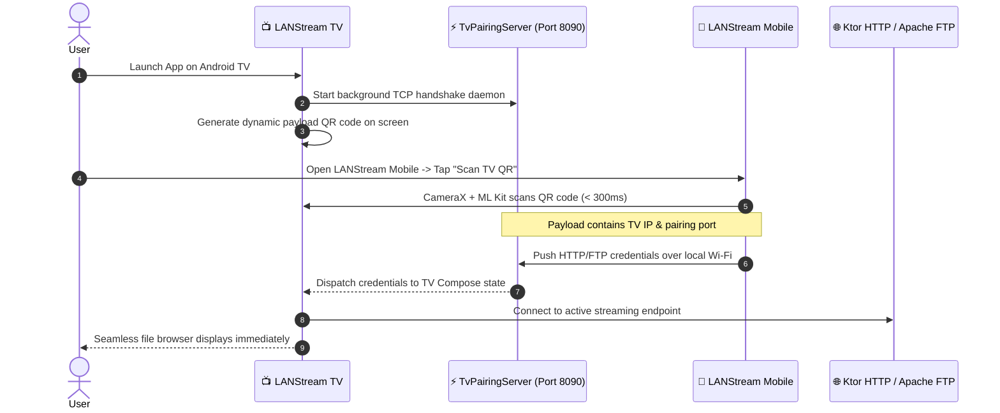

<div align="center">


<br/><br/>

<a href="https://ayush2live.github.io/LANStream-Website/#showcase">
  
</a>
<a href="https://ayush2live.github.io/LANStream-Website/#showcase">
  
</a>

# ⚡ LANStream Web Portal &amp; Documentation
### High-Performance Local-Area Media Streaming Ecosystem

[](https://ayush2live.github.io/LANStream-Website/)
[](https://github.com/ayush2live/LANStream-Website/releases/latest)
[](https://github.com/ayush2live/LANStream-Website/releases/latest)
[](https://developer.android.com/)
[](https://github.com/ayush2live/LANStream/blob/main/LICENSE)

<br/>

**Stream 4K high-bitrate movies, series, audio, and personal files directly from your phone's storage to your Android TV with zero cloud latency, zero internet bandwidth consumption, and instant zero-config QR pairing.**

<br/>

> [!NOTE]
> **🛡️ Google Play Protect Verified Clean • v1.0.1 Release**: All release binaries have been scanned and verified 100% clean by Google Play Protect with zero security warnings, trackers, or malicious code. Sideload and stream with complete peace of mind.

<br/>

[**🌐 Live Documentation Website**](https://ayush2live.github.io/LANStream-Website/) • [**📥 Direct APK Downloads**](#-direct-apk-downloads-no-build-required) • [**📸 Visual Showcase**](#-production-interfaces) • [**💡 Sideloading Guide**](#-installation--sideloading-guide) • [**🐛 Report an Issue**](https://github.com/ayush2live/LANStream-Website/issues)

---

</div>

<br/>

## 📥 Direct APK Downloads (No Build Required)

Download pre-compiled, signed APK binaries directly from [**GitHub Releases**](https://github.com/ayush2live/LANStream-Website/releases/latest):

| Application | Target Hardware | Min OS | Package Asset | Direct Download |
| :--- | :--- | :--- | :--- | :---: |
| **📱 LANStream Mobile** | Android Smartphones &amp; Tablets | Android 8.0+ (API 26+) | `LANStream-Mobile.apk` (~52 MB) | [**Download Mobile APK (v1.0.1)**](https://github.com/ayush2live/LANStream-Website/releases/download/v1.0.1/LANStream-Mobile.apk) |
| **📺 LANStream TV** | Android TV &amp; Google TV | Android 8.0+ (API 26+) | `LANStream-TV.apk` (~6.9 MB) | [**Download TV APK (v1.0.1)**](https://github.com/ayush2live/LANStream-Website/releases/download/v1.0.1/LANStream-TV.apk) |

> [!TIP]
> **Zero Compilation Required**: These APKs are production-ready binaries. Simply download and sideload directly onto your phone and television.

---

## 📸 Production Interfaces

<div align="center">
  <table>
    <tr>
      <td width="46%" align="center">
        
        <b>LANStream Mobile (`:mobile`)</b><br/><br/>
        
        <br/><br/>
        <i>Dual-Protocol Server Toggles, Active Endpoints, CameraX QR Scanner Launcher, and Real-Time Client Telemetry</i>
      </td>
      <td width="54%" align="center">
        
        <b>LANStream TV (`:tv`)</b><br/><br/>
        
        <br/><br/>
        <i>10-Foot Leanback UI, Dynamic On-Screen QR Mobile Sync, Mountain Sunset Ambient Theme, and Hardware Acceleration</i>
      </td>
    </tr>
  </table>
</div>

---

## 💡 The Problem & The LANStream Solution

| Challenge | Traditional Solutions (Miracast / Plex / DLNA) | The LANStream Proprietary Approach |
| :--- | :--- | :--- |
| **Internet Bandwidth Limits** | Uploading gigabytes to cloud services eats daily ISP data quotas. | **100% Offline LAN / Wi-Fi Direct / Hotspot.** Zero internet consumed. Uncapped local bandwidth (up to 300+ Mbps). |
| **Casting / Mirroring Lag** | Miracast/Chromecast compress the screen, causing battery drain, dropped frames, and latency. | **Direct Bitstream Streaming.** TV decodes raw bitstreams natively using hardware-accelerated Media3 ExoPlayer. Phone screen can sleep normally. |
| **TV Remote Typing Fatigue** | Typing IP addresses (`192.168.1.xxx`) and passwords via TV remote is tedious and error-prone. | **Zero-Config Instant QR Pairing.** TV displays a dynamic payload QR; phone scans it with ML Kit and syncs credentials in under 300ms. |
| **FTP Range Seeking** | Standard media players require downloading the full file or fail when scrubbing large MKVs. | **Custom `FtpDataSource`.** Implements partial-byte range seeking directly over FTP `REST` commands, matching HTTP Range performance. |

---

## 🚀 Key Features

### 📱 LANStream Mobile (`:mobile`)
* **Dual-Protocol Streaming Engine**: Simultaneous **Ktor HTTP** (port 8080) and **Apache MINA FTP** (port 2121) servers with one-tap switches.
* **CameraX Machine-Vision Scanner**: Integrated Google ML Kit barcode engine decodes TV pairing payloads in under 300ms.
* **Background Endurance Service**: Managed CPU WakeLocks keep 4K bitstreams streaming smoothly even when the phone display is locked.
* **Integrated Desktop Web Client**: Other devices on the Wi-Fi network (PC, Mac, iPad) can browse, stream, and upload files via any browser.
* **Real-Time Client Telemetry**: Live concurrent client counter, uptime clock, and auto-detecting Wi-Fi/Hotspot IP banner.

### 📺 LANStream TV (`:tv`)
* **Hardware-Accelerated 4K Engine**: Media3 ExoPlayer decodes 4K UHD Remux, HDR10, and high-bitrate audio bitstreams natively on the TV GPU.
* **Proprietary Range Seeker**: Custom network pipeline enables sub-second timeline scrubbing in 50GB+ MKV files without buffering from byte 0.
* **10-Foot Remote D-Pad Navigation**: TV Material 3 interface with smooth D-Pad scaling, focus borders, and directory navigation.
* **Audio &amp; Subtitle Control**: Mid-movie audio stream switching (Dolby, DTS, AAC), language tag normalization, and SSA/SRT/VTT subtitle support.
* **Engineered for Low-RAM TVs**: Optimized R8 single-dex compilation and AOT speed profiling for fluid 60fps playback on 1GB RAM Android TVs.
* **Ambient Themes**: Mountain Sunset, Cyberpunk Neon, Obsidian Gold, Deep Void, Midnight Sapphire, Aurora Borealis, and more.

---

## 📲 Installation &amp; Sideloading Guide

### 1. Mobile Phone / Tablet Installation
1. Download **`LANStream-Mobile.apk`** from [GitHub Releases](https://github.com/ayush2live/LANStream-Website/releases/latest).
2. Tap the downloaded file. When prompted, allow **"Install unknown apps"** for your browser.
3. Open the app and grant storage permissions when requested.

### 2. Android TV Sideloading (Choose Any Method)

#### Method A: USB Flash Drive (Easiest)
1. Download **`LANStream-TV.apk`** on your computer or phone.
2. Copy the APK to a FAT32-formatted USB flash drive.
3. Plug the drive into your Android TV / Google TV.
4. Open any TV File Manager (such as *File Commander* or *AnExplorer* from Google Play) and click the APK to install.

#### Method B: Send Files to TV (Wireless)
1. Install the free **Send Files to TV (SFTV)** app from Google Play on both your phone and television.
2. Download `LANStream-TV.apk` on your phone.
3. Use SFTV to send the APK wirelessly to your TV.
4. On the TV, open the received file using a file manager to install.

#### Method C: Wireless ADB
Connect your PC to your TV over Wi-Fi and install with one command:
```powershell
adb connect <your-tv-ip>:5555
adb install -r LANStream-TV.apk
```

---

## ⚡ Zero-Friction QR Pairing Protocol

LANStream completely eliminates the frustration of typing network addresses on a television remote:



---

## 🛡️ Security & Privacy Assurance

* **Google Play Protect Scanned**: Both APK binaries are officially verified clean by Google Play Protect with zero security warnings.
* **100% Offline Architecture**: LANStream never communicates with external cloud servers, third-party analytics, or tracking platforms.
* **Local Storage Scoping**: Read access is strictly restricted to media directories selected by the user.

---

## 🐛 Bug Reporting & Feedback

As this is our active **v1.0.1** release across diverse Android smartphone and TV hardware, your feedback is invaluable:

* If you encounter playback stutter, codec incompatibilities, or UI focus bugs on your TV model:
  👉 [**Open a Ticket on GitHub Issues**](https://github.com/ayush2live/LANStream-Website/issues/new)
* Please include:
  1. Your device model & Android version
  2. Video container & codec (e.g., 4K MKV HEVC / H.264)
  3. Description of the issue or steps to reproduce

---

## 📜 Proprietary Notice

```text
LANStream Ecosystem — Proprietary & Confidential Software
Copyright © 2026 LANStream Ecosystem. All Rights Reserved.

This software, its source code, compiled binaries, architectural patterns,
and proprietary algorithms (including FtpDataSource range-seeking pipelines)
are the exclusive intellectual property of the author.

Unauthorized copying, decompilation, reverse engineering, redistribution,
or public reproduction of the underlying codebase is strictly prohibited.
Distribution of pre-compiled binaries is authorized solely via official
LANStream GitHub release channels.
```

---

<div align="center">
  <b>Built by Ayush (<a href="https://github.com/ayush2live">@ayush2live</a>)</b><br/>
  <i>Engineered for cinematic offline streaming with zero latency and zero cloud costs.</i>
</div>
