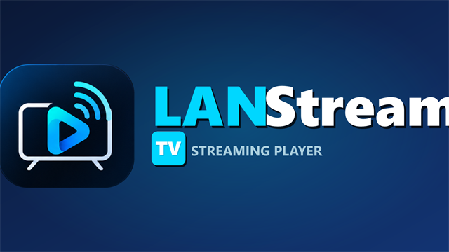

  

# ⚡ LANStream Web Portal &amp; Documentation

 

Official documentation website and pre-compiled APK distribution hub for **LANStream Mobile** &amp; **LANStream TV**. All release binaries are scanned and verified clean by **Google Play Protect**.

 

[**🌐 Open Live Website**](https://ayush2live.github.io/LANStream-Website/) • [**📱 Download Mobile APK (v1.0.1)**](https://github.com/ayush2live/LANStream-Website/releases/download/v1.0.1/LANStream-Mobile.apk) • [**📺 Download TV APK (v1.0.1)**](https://github.com/ayush2live/LANStream-Website/releases/download/v1.0.1/LANStream-TV.apk) • [**🐛 Report an Issue**](https://github.com/ayush2live/LANStream-Website/issues)

---

## 📸 Production Interfaces

  <table>
    <tr>
      <td width="48%" align="center">
        
        <b>LANStream Mobile</b>  
        
      </td>
      <td width="52%" align="center">
        
        <b>LANStream TV</b>  
        
      </td>
    </tr>
  </table>

---

  <i>&copy; 2026 LANStream Ecosystem. Proprietary Software. All Rights Reserved.</i>

